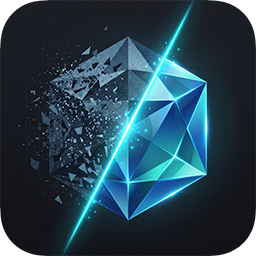
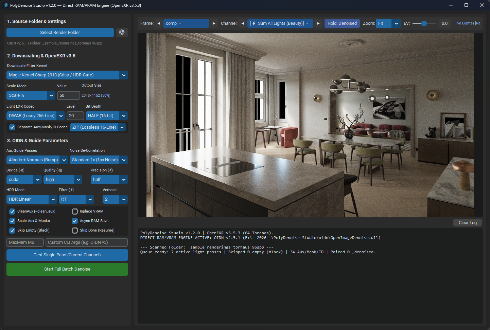

<div align="center">
  
  <h1>PolyDenoise Studio</h1>
  <p><strong>High-Performance Direct RAM/VRAM AI Batch Denoiser, SOTA HDR Downscaler & OpenEXR v3.5.3 Pipeline</strong></p>
  <p>
    <a href="#-key-features">Key Features</a> •
    <a href="#-ready-for-oidn-v30-alpha">OIDN v3.0 Ready</a> •
    <a href="#-sota-downscaling--smart-data-pass-protection">Downscaling & AOV Protection</a> •
    <a href="#-openexr-v353-codec-engine">OpenEXR v3.5.3</a> •
    <a href="#-quick-start-python--bundled-dlls">Quick Start</a> •
    <a href="#-credits--license">License</a>
  </p>
</div>

<div align="center">
  
</div>

**PolyDenoise Studio** is a high-performance, hardware-accelerated Python desktop application built around **Intel® Open Image Denoise (OIDN v2.5+)** and **OpenEXR v3.5.3**. Originally engineered for in-house architectural visualization and CGI production pipelines at [**Polygon Manufaktur**](https://www.polygonmanufaktur.de/?utm_source=github_polydenoise) (supporting Indigo Renderer, Cinema 4D, Blender, Maya, and 3ds Max), it eliminates the disk I/O bottlenecks of traditional command-line wrappers and pairs neural denoising with mathematically rigorous post-downscaling.

> 💡 **Companion Tool:** Pair your denoised and downscaled light layers directly with [**PolyLightMix**](https://github.com/polygonmanufaktur/PolyLightMix) for interactive real-time WebGL relighting, Kelvin color temperature grading, Z-Depth DoF, and ACES tonemapping.

## ⚡ Key Features

### 1. Zero-Disk-I/O Direct RAM/VRAM Engine (`ctypes` C-API)
* **No Temporary `.pfm` Files:** Legacy OIDN wrappers write hundreds of megabytes of uncompressed `.pfm` files to disk for every single pass. **PolyDenoise Studio** binds directly to `OpenImageDenoise.dll` in memory.
* **Dedicated GPU Device Buffers (`OIDN_STORAGE_DEVICE`):** Allocates native VRAM buffers directly on your GPU (NVIDIA CUDA Tensor Cores, AMD HIP, Intel SYCL, or Apple Metal) in `FP16 (OIDN_FORMAT_HALF3)` or `FP32 (OIDN_FORMAT_FLOAT3)`.
* **Persistent Per-Frame Guide Caching:** `Albedo` and `Normals` (Bump or Pre-Bump) are uploaded to GPU VRAM **only once per frame** and reused across all lighting layers (`direct`, `indirect`, `specular`, `sss`, and custom light groups).
* **Integrated GPU vs. CPU Hardware Benchmark:** Built-in benchmark suite (`oidnBenchmark.exe`) with real-time progress tracking and speedup factor evaluation across 1080p, 4K, and 720p HDR passes.
* **Multi-GPU Workarounds Built-In:** Automatically bypasses the OIDN 2.4/2.5 hybrid-GPU SYCL crash (Issue #285) and sanitizes negative/NaN/Inf values to prevent rainbow artifacts (Issue #292).

### 2. Universal AOV & Multi-Pass Auto-Parser
* **Exporter Agnostic:** Automatically parses and groups render passes regardless of naming convention (`<scene>_channels_<pass>.exr`, `<scene>_<pass>.exr`, `<scene>.<pass>.exr`, or `<scene>-<pass>.exr`).
* **Instant First-Pass Preview & Background Scanner:** Displays the first lighting pass immediately upon selecting a folder while scanning remaining passes and pre-caching counterparts asynchronously in the background.
* **Smart Channel Linking:** Detects `albedo`, `normals`, `normals_pre_bump`, `depth`, `position`, `alpha`, `material_id`, `object_id`, `material_mask`, `object_mask`, and arbitrary custom light names, pairing each light pass with its corresponding frame guides.
* **Automatic Empty (100% Black) Pass Detection:** Scans light layers using a fast strided sensor, marks inactive lights with **`⚫ [Empty]`** in the UI, and automatically skips them during batch denoising (`0.0s` wasted GPU time, zero hallucinated ghost edges from guide passes).

## 🚀 Ready for Intel® OIDN v3.0 Alpha

**PolyDenoise Studio** has been architected from the ground up to support the upcoming **Intel® Open Image Denoise 3.0 Alpha** generation as soon as it is released:
* **Kernel Prediction & Composable AOV Ready:** Designed around linear light-layer separation (`direct`, `indirect`, `specular`, and custom light groups) to take immediate advantage of OIDN 3.0's upcoming **Composable AOV Support** and next-generation **Final Frame / Viewport / Lightmap Spatial Filters**.
* **Future-Proof Custom Flag Injection & Dynamic DLL Loader:** Includes direct pass-through support for upcoming OIDN 3.0 parameters (such as temporal denoising and neural upscaling flags) alongside an integrated **GitHub Release Version Checker** that notifies you the moment a new OIDN or OpenEXR release drops.

## 🔍 SOTA Downscaling & Smart Data-Pass Protection

Instead of using in-renderer supersampling filters that correlate noise across $2\times 2$ or $3\times 3$ pixels (which blinds OIDN's $1\times 1$-trained neural kernels), **PolyDenoise Studio** enables the **200% Supersampling Workflow**:
Render at double resolution with uncorrelated $1\text{px}$ box-filtered noise $\rightarrow$ denoise at full resolution in VRAM $\rightarrow$ downscale to your exact target size (`Scale %`, `Target Width px`, or `Target Height px` with automatic even-pixel rounding).

### Selectable C++ AVX2 SIMD & Polyphase Downscale Kernels
* **Magic Kernel Sharp 2013 (Crisp / HDR-Safe — *Default*):** John Costella's quadratic B-spline decimation kernel (zero negative lobes, zero Moiré) paired with a matched 3-tap deconvolution sharpener and **Karis HDR Luma Weighting** ($w = \frac{1}{1 + Y}$) to prevent dark ringing halos around extreme specular highlights.
* **MKS 2013 Unclamped (Pure Linear):** Unclamped linear deconvolution for scenes without raw visible emitters where maximum micro-texture bite is desired.
* **Lanczos-4 Unclamped (16-Tap Sinc):** Surgical high-frequency acuity for fine architectural textures.
* **Catmull-Rom Bicubic ($B=0, C=0.5$):** The classic sharp ArchViz downsampling filter.
* **Magic Kernel Sharp 2021 (Balanced SOTA):** 6-tap B-spline + 7-tap deconvolution for ultra-clean anti-aliasing.
* **Lanczos-3 + Local Anti-Ringing:** 12-tap Sinc kernel with strict $2\times 2$ neighborhood min/max clamping.
* **Mitchell-Netravali ($B=\frac{1}{3}, C=\frac{1}{3}$):** Smooth VFX production standard.

### Pass-Type Aware Auxiliary & Mask Scaling
Standard sharpening filters destroy data passes by blending discrete IDs or introducing negative overshoots into masks. **PolyDenoise Studio** automatically routes each non-beauty pass through its mathematically appropriate resampler:
* **`material_id` & `object_id`:** Strictly scaled via **Nearest-Neighbor** (preserving both `float32` and native `uint32` discrete integer IDs) so edge pixels never blend into false intermediate IDs.
* **`material_mask`, `object_mask` & `alpha`:** Scaled via overshoot-free **Mitchell-Netravali** and strictly clamped to $[0.0, 1.0]$.
* **`depth`, `position` & `normals`:** Scaled via pure linear polyphase interpolation without Karis luma distortion, preserving full **32-bit Float (`FP32`)** precision on Z-Depth and World Position passes to prevent depth-stepping artifacts.

## 📦 OpenEXR v3.5.3 Codec Engine & Dual-Compression Pipeline

Built on the latest **OpenEXR v3.5.3** C++ core with balanced multi-threaded **Async RAM Write-Behind Queues** (compressing EXRs in system RAM on background CPU threads while the GPU immediately denoises the next pass):

* **Beauty & Light Layer Codecs:**
  * **`DWAB` / `DWAA` (Default Level `20`):** Fast, high-ratio lossy DCT compression for lighting passes (embedded Alpha channels remain lossless automatically).
  * **`ZSTD` (OpenEXR v3.5):** Modern, high-speed lossless compression (Levels `1–22`).
  * **`LJ2K` (OpenEXR v3.5 Lossy HTJ2K) & `HTJ2K256` / `HTJ2K32` (v3.4 Lossless):** High-Throughput JPEG 2000 codecs.
  * **`ZIP`, `ZIPS`, `PIZ`, `RLE`, `NONE`:** Classic lossless studio formats.
* **Dedicated Lossless Codec for Aux / Masks / IDs / Depth:**
  * Independently compresses flat masks, ID maps, and depth passes using **`ZIP (16-Line)`**, **`ZSTD`**, or **`RLE`**, shrinking flat mask files to a few kilobytes while avoiding lossy DCT ringing on sharp mask edges.
  * Automatically writes the **OpenEXR v3.5 `colorInteropID = "data"`** header attribute into non-color data passes so downstream color management (OCIO / Nuke / DaVinci Resolve) never applies gamma curves to normals, depth, or IDs.

## 🖥️ Interactive Real-Time Viewport

* **0ms Hold-Click (or `Spacebar`) A/B Comparison:** Press and hold the Left Mouse Button anywhere on the image to toggle between the denoised pass and the raw input pass (automatically filtered with the identical downscale kernel and target resolution for a true 1:1 pixel comparison).
* **`[⚡ Sum All Lights (Beauty)]` Virtual Channel:** Dynamically sums all active light passes of the current frame in linear space so you can inspect the full relight composite before exporting.
* **60fps Real-Time Exposure (`EV`) Slider:** Driven by a precomputed 12-bit sRGB lookup table (`<2ms` latency directly on cached RAM float arrays) combined with **Interleaved Gradient Noise (IGN) TPDF Dithering** to eliminate 8-bit Mach-banding in smooth gradients.
* **Searchable & Scrollable Selectors:** Instant search filtering and `◀` / `▶` step buttons for animations with 1,000+ frames.

## 🛠️ Quick Start (Python + Bundled OIDN DLLs)

**PolyDenoise Studio** automatically detects the bundled Intel OIDN binaries in the `./oidn/` subfolder—zero manual configuration required.

### 1. Launch via Batch Starter (Auto-Installs Dependencies)
Simply double-click **`start.bat`**. On first launch, it automatically installs `OpenEXR>=3.5.3`, `customtkinter`, `opencv-python`, `numpy`, and `Pillow` if missing, and starts the GUI.

### 2. Or Run Manually via Terminal (Python 3.10 – 3.14)
```bash
pip install -r requirements.txt
python indigo_oidn_gui.py
```

## 📄 Credits & License

* **PolyDenoise Studio Application Code:** MIT License — Created by Arthur Liebnau ([**Polygon Manufaktur**](https://www.polygonmanufaktur.de/?utm_source=github_polydenoise))
* **Companion Relighting Tool:** [**PolyLightMix**](https://github.com/polygonmanufaktur/PolyLightMix)
* **Bundled Intel® Open Image Denoise Binaries (`./oidn/`):** Licensed under the **Apache License 2.0** (Copyright © Intel Corporation). Full license text and required third-party notices for bundled runtimes (`oneTBB`, `oneAPI DPC++`, `Level Zero`, `CUTLASS`, `HIP`) are included in [`./oidn/LICENSE.txt`](oidn/LICENSE.txt) and [`./oidn/third-party-programs.txt`](oidn/third-party-programs.txt).
* **OpenEXR:** BSD-3-Clause License ([AcademySoftwareFoundation/openexr](https://github.com/AcademySoftwareFoundation/openexr))
* **Magic Kernel Sharp:** Mathematics by John Costella

*Intel and the Intel logo are trademarks of Intel Corporation or its subsidiaries. PolyDenoise Studio is an independent open-source project and is not affiliated with or endorsed by Intel Corporation.*
<!-- END OF README -->